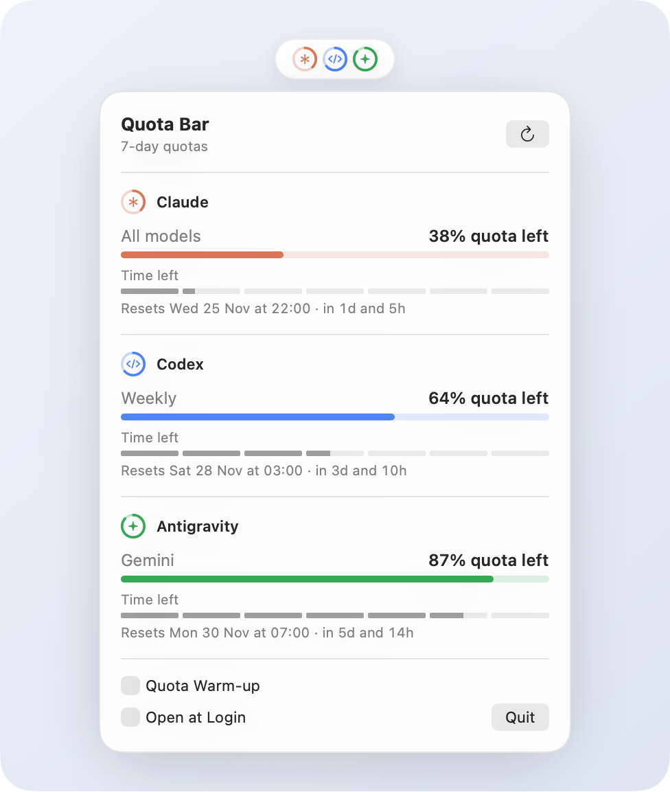

# Quota Bar

Quota Bar puts the weekly limits for Claude, Codex, and Google Antigravity (Gemini) in your Mac menu bar. Click the rings and choose **7d** or **5h** to see how much quota and time remain, and when each limit resets.



## Install

Requires macOS 14 or later. Download [QuotaBar-macOS.zip](https://github.com/Decryptu/quota-bar/releases/latest), unzip it, and move **Quota Bar.app** to Applications. The app is ad hoc signed and macOS may require approval in **System Settings → Privacy & Security** on first launch.

Install the quota helper and, for Antigravity, its CLI:

```sh
brew install --cask codexbar
brew install --cask antigravity-cli
```

Quota Bar reads usage from your existing sign-ins through the CodexBar CLI. Its menu bar app can stay closed. If Antigravity usage is missing, run `agy` in Terminal to sign in. Enable **Open at Login** in Quota Bar to start it automatically.

## Limit Resets

When Claude or Codex gives you a free limit reset, Quota Bar shows how many you have and when the next one expires. Click **Use…** to spend one: a confirmation dialog shows your current usage first, and Cancel is the default button. Quota Bar sends one request per confirmation, through your existing Claude Code or Codex CLI sign-in, and never uses a reset on its own. Antigravity doesn't offer resets.

## Quota Warm-up

Off by default. When a supported five-hour window is idle, Quota Bar can send a short prompt through the signed-in provider CLI to start the clock. The prompt counts toward your quota.

If you use up the quota two hours after starting work, a five-hour window leaves three hours to wait. If the window started two hours before work, there's only one hour left. While that same window is active, the wait after reaching the limit is `5h - time since the window started`.

## Build

Run `./build.sh` to build `dist/Quota Bar.app`.
